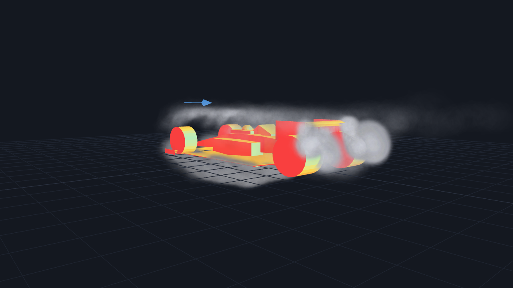

# Motorsport Aero Simulator

Formula open-wheel aerodynamics workbench: a 3D vortex-lattice solver, a real
OpenFOAM RANS tier for the front-wing section, a multi-fidelity surrogate with
an active-learning loop, and a browser wind-tunnel visualization — all wired to
a validation harness that reports its failures.

The point of this project is not the downforce numbers. It is that every result
carries a provenance label saying what produced it, and every validation target
is recorded whether it passed or not.

[](https://github.com/JefryV2/motorsport-aero-simulator/actions/workflows/ci.yml)




*Volumetric smoke over the built-in car. It is metric and parametric: the four wing
elements, floor, diffuser and ride heights are placed from the same config the VLM
solves, so a setup change moves the body and the numbers together. The field is
analytic potential flow, not a CFD result. Upload your own CAD mesh to replace the
body — an imported mesh has no solved geometry, so it keeps the bounding-box
approximation.*

## Quick start

```bash
python -m venv .venv
.venv\Scripts\activate          # Windows  |  source .venv/bin/activate on POSIX
pip install -r requirements.txt
copy .env.example .env          # optional: OPENAI_API_KEY for the LLM advisor
python -m uvicorn backend.main:app --port 8000
```

Open <http://localhost:8000>. Requires Python 3.10+; CI runs 3.10 and 3.11.

OpenFOAM is optional. Without a solver the app still runs, and the CFD tab
reports an explicitly labelled `synthetic_model` result instead of pretending.
To use the real tier, install OpenFOAM (e.g. 1912 in WSL2 Ubuntu 22.04) with
`simpleFoam`, `checkMesh` and `yPlus` on the distro's `PATH`, then restart the
server; `/api/health` reports the detected backend.

## Three force tiers

| `method` | What runs | Fidelity label |
|---|---|---|
| `analytical` | Semi-empirical wings + ground effect + diffuser | `empirical` |
| `analytical_enhanced`, `panel_vlm` | 3D horseshoe vortex lattice, image ground plane, Trefftz drag. This is the live preview. | `low_fidelity_vlm` |
| `cfd` | Real 2D front-wing-section k-ω SST RANS, combined with empirical floor and rear-wing terms | `rans_hybrid`, or `synthetic_model` when no solver exists |

`analytical_enhanced` and `panel_vlm` are the **same code path** — `panel_vlm` is
kept as a legacy alias, and only the echoed label differs. A real solver failure
returns HTTP 503; it never silently substitutes synthetic numbers.

The CFD tier is a 2D section, not a full car. It writes a body-fitted O-grid
`polyMesh` directly (wall facets exactly on an inverted NACA 4412, first-cell
height from a target y+, moving-ground wall patch), solves steady RANS, and
reports measured y+ and `checkMesh` quality per run. See
`docs/decisions/0006-body-fitted-ogrid-mesh-family.md`.

## Optimization and advice

- **Bayesian optimizer** (Optuna TPE) over wing angles, ride heights, rake,
  diffuser and gurney flaps. It always uses the fast VLM path — real CFD is
  single-point verification, never a 100-case inner loop. The UI runs 30 trials
  with an elapsed-time counter.
- **Advisor** posts to any OpenAI-compatible endpoint (`LLM_BASE_URL`,
  `LLM_MODEL`; default `gpt-4o-mini`) and falls back to a rule-based advisor
  with no key. Rule-based advice labels improvement as a normalized objective
  score; the lap delta is a same-fidelity relative proxy, not a lap time.

## Wind-tunnel visualization

Drag in STL, OBJ, GLB, GLTF, FBX, DAE or PLY in the browser (the `/api/models/upload`
endpoint persists only `.stl` and `.obj`), or use the built-in car — a metric formula
car assembled from the same setup fields the solver reads, so wing angle, chord, span,
gurney, ride heights and diffuser angle all move the body. Nine seeding
sources — front grid, front wide plane, a 45-tube smoke rake (5 heights × 9
lateral), surround fill, interactive wand, from above, both sides, ring — feed
50–1000 tracers through:

- **Volumetric smoke** (default): isotropic, noise-warped puffs that grow and
  dilute downstream, tinted by speed only when you ask for it.
- **Smoke filaments**: thin near-white threads, like a rake photograph.
- **Classic dots**, plus streamlines, a slice plane, force vectors and a
  heuristic Cp map.

The field is **analytic potential flow, not CFD**: doublet blockage, line-vortex
pairs with Biot–Savart induction, a floor sink and diffuser source, a 1/7-power
boundary layer, ground no-penetration, and divergence-free curl-noise turbulence.
Nothing is sampled from OpenFOAM, and the UI says so in the panel.
`scripts/check_flow_field.mjs` gates it — 37 assertions covering finiteness, a
bounded perturbation, divergence-free turbulence, spatial coherence, streamline
progress, the boundary-layer and wake profiles, and inlet/rake coverage, plus the
parametric car: solved stations driving the singularities, the browser-side lift
terms still matching `backend/simulation/analytical.py`, every setup knob that
moves the body also moving the smoke, and the field unchanged under display scale:

```bash
node scripts/check_flow_field.mjs
```

## Validation: the honest ledger

Each check is a runnable script that prints measured values and its own verdict.
Status as of 2026-11-02, recorded in `docs/STATUS.md`:

| Check | Measures | Verdict |
|---|---|---|
| V1 | 2D lift-curve slope vs thin-airfoil | Pass — e = 1.016, Cl error 2.7% |
| V2 | Finite-AR lift slope vs lifting line | Pass with caveat — AR ≥ 4 within 3.2%, AR = 2 at 15.4% |
| V3 | Grid convergence, 4 levels | Pass — monotonic, GCI < 1.5% |
| V4a | Ground-effect image system | Pass — 3.7% |
| V4b | Ground effect vs Zerihan/Zhang | **Pending** — model 2.585 vs published 1.34 at h/c = 0.15, ≈ 1.93× |
| V5 | Mesh independence, O-grid family | **Pass** — r₂₁ = 1.501, p = 3.219, GCI(fine) 0.615%, asymptotic ratio 0.985. The fine solve hit the 2000-iteration cap and is flagged unconverged |
| V6a | Section vs published lift slope | **Miss** — 0.0902 vs 0.1081 per deg, 16.58% error against a 4% target. Cd0 delta 0.00071 passes |
| V6b | Ride-height trend vs literature | Trend only — geometry differs from the cited wing |
| V7 | Surrogate cross-validation | **All 4 targets met** — Cl R² 0.9952 (MAPE 1.15%), Cd R² 0.9907 (MAPE 0.23%) |
| V8 | Multi-fidelity gain | **2 of 3** — low-fidelity-fusion R² 0.9979 and coverage pass; the N = 6 cost-reduction target misses at −410.8% |
| V9 | Active learning vs space-filling | **Not met (1 of 3)** — beats random by +17.6%, but loses to maximin by −16.8% and the strict yield check fails |
| P4.3 | Sobol sensitivity | Pass — ST for Cl on front ride height 0.575 ± 0.112, Cd 0.850 ± 0.130, stable to N = 512; bootstrap seed pinned so the output is byte-reproducible |
| V10–V12 | Lap simulation, multi-objective, correlation | Not started |

```bash
.venv\Scripts\python.exe validation\v5_grid_independence.py     # runs real solves
.venv\Scripts\python.exe validation\v6_cfd_benchmark.py
.venv\Scripts\python.exe validation\v7_surrogate_cv.py
.venv\Scripts\python.exe validation\v8_multifidelity_gain.py
.venv\Scripts\python.exe validation\v9_active_learning.py
```

## Data and provenance

`data/datasets/aero_surrogate_v1.parquet` is **28 real OpenFOAM points** (WSL,
medium mesh), 13 converged, 0 diverged, sampled inside the V6-validated
envelope (total incidence ≤ 8°, front ride height 71–150 mm). Every row carries
`is_synthetic`, `hf_failed`, `convergence_flag`, `solver_used` and
`cfd_mesh_cells`, and the run is described by
`aero_surrogate_v1_provenance.json`. Failed solver points are kept with
`hf_failed = True` and NaN high-fidelity targets — never filled with invented
numbers. The earlier 100-row synthetic set is retained, labelled, at
`aero_surrogate_v1_synthetic_backup.parquet`.

```bash
.venv\Scripts\python.exe scripts\generate_real_dataset.py --samples 28 --max-workers 1
```

That refuses to run when no solver is present. A full cold regeneration is roughly
70 minutes for 28 serial medium cases (8 minutes with the cases already warmed).

## Tests, lint, CI

```bash
.venv\Scripts\python.exe -m pytest            # 33 fast tests
.venv\Scripts\python.exe -m pytest -m slow     # 6 that run real solves
.venv\Scripts\python.exe -m ruff check .      # line length 100
.venv\Scripts\python.exe -m mypy backend      # warn_return_any
node scripts/check_flow_field.mjs              # 37 browser-side assertions
```

`slow` is deselected by default (`pyproject.toml`). GitHub Actions runs the fast
suite plus ruff and mypy on 3.10 and 3.11, and the flow-field script on the
runner's Node — the viewer modules need no build step and no dependencies.

## API

| Method | Endpoint | Notes |
|---|---|---|
| GET | `/api/health` | CFD backend, solver version, readiness |
| POST | `/api/simulate?method=…` | One of the three tiers above |
| POST | `/api/simulate-and-optimize` | Simulate → optimize → advise; used by the UI |
| POST | `/api/aero-map` | Ride-height map on the fast VLM path |
| POST | `/api/advise` | LLM or rule-based recommendations |
| POST | `/api/models/upload` | `.stl` / `.obj`, 50 MB cap |
| GET | `/api/models/{model_id}` | Retrieve an uploaded model |
| POST | `/api/aero-field` | Heuristic Cp field — API only, the UI computes it client-side |
| POST | `/api/visualization` | Streamlines and force vectors — API only |
| POST | `/api/optimize` | Optimizer alone; the UI goes through `simulate-and-optimize` |

Interactive docs at <http://localhost:8000/docs>.

## What this is not

- Not full-car CFD. The `cfd` tier is a 2D section plus empirical terms.
- Not a validated ground-effect magnitude. V4b is 1.93× off the published
  reference and is still open.
- Not a proven active-learning win. V9 fails 2 of its 3 checks and says so.
- The Cp field is a heuristic visualization, not a solved pressure distribution.
- The surrogate is exercised by the validation scripts, not yet by the live
  optimizer.
- The lap-time delta is a relative proxy within one fidelity family.
- Phases 5–8 of `docs/BLUEPRINT.md` (vehicle model and lap simulation,
  multi-objective optimization, correlation, integration report) are not
  implemented.

## Repo map

```
backend/          FastAPI app, VLM, analytical model, OpenFOAM runner, ML surrogate, optimizer, advisor
frontend/         Vanilla JS + Three.js client, no build step
validation/       V1-V9 runnable checks that print their own verdicts
scripts/          Flow-field gate, dataset generator, guarded V7/V8 runner
tests/            33 fast + 6 slow
docs/             BLUEPRINT.md (phases), STATUS.md (living log + measured numbers),
                  REPORT.md, AUDIT.md, COORDINATES.md, DESIGN.md, decisions/ (ADRs)
```

Read `docs/STATUS.md` for measured numbers and `docs/decisions/` for why the
design choices were made.
